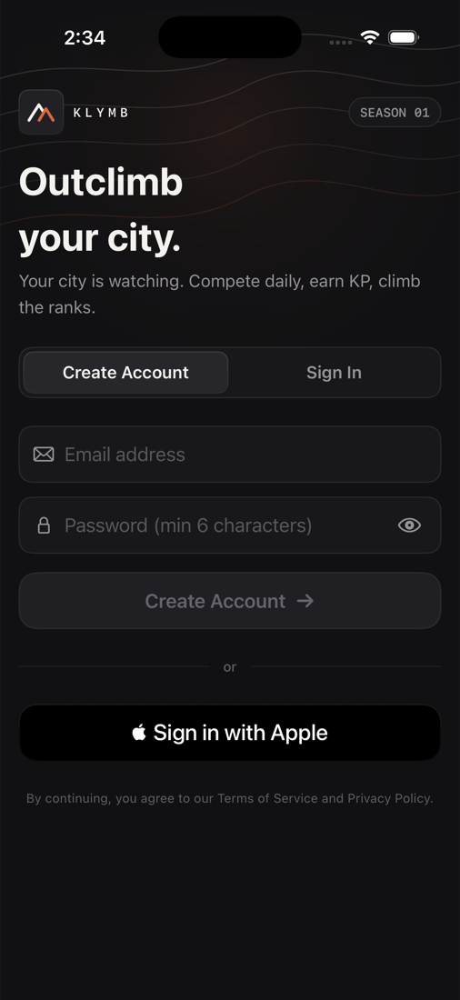
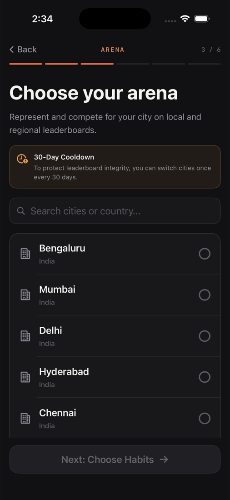
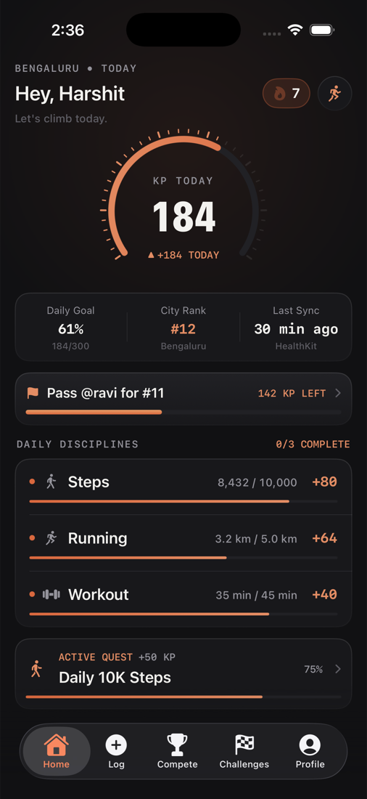
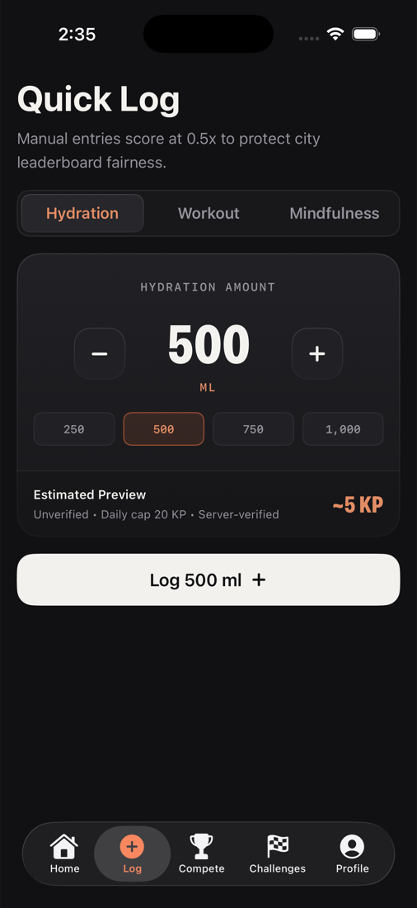
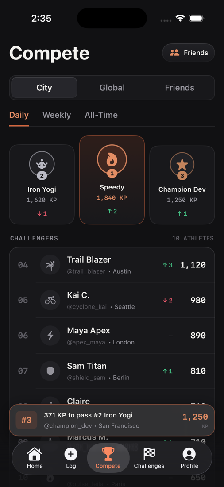
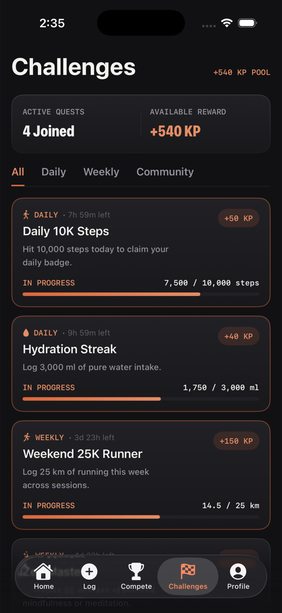
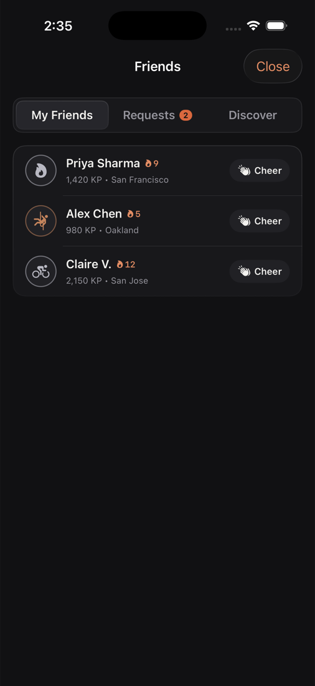
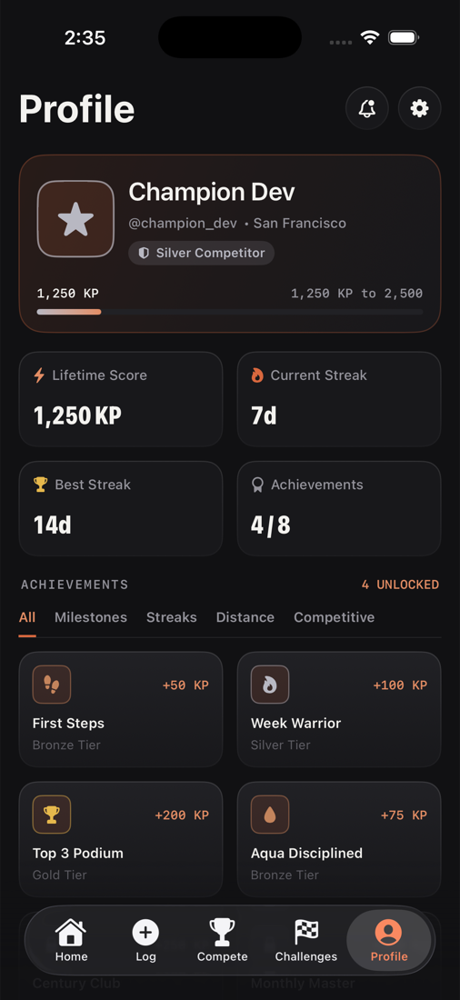
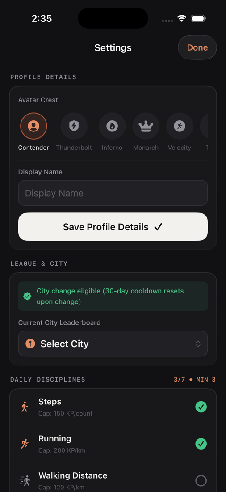
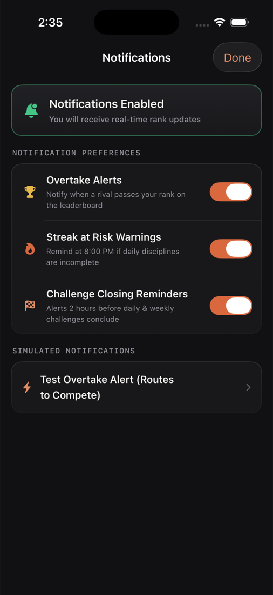

# Klymb

A competitive lifestyle gaming platform for iOS — earn **Klymb Points (KP)** from real-world movement and daily habits, climb city leaderboards, complete quests, and challenge friends.

Built end-to-end with **SwiftUI (MVVM + Protocol DI)** and a live **Supabase Backend (Postgres, Auth, RLS, Edge Functions)**.

---

## Visual Showcase (iPhone 17 Pro • Live App Captures)

Designed around a low-glare **Matte Charcoal & Velvet Terracotta** visual language built for 6 AM and post-workout eye comfort: calm dark neutrals (`#111113` canvas, `#18181B` surfaces) paired with desaturated **Velvet Terracotta** (`#D9683E`) for active effort and **Calm Mint** (`#45C486`) when goals hit 100%.

### Core Loop & Auth
| Auth & Identity | Arena Onboarding (30-Day Lock) | Home KP Cockpit | Quick Activity Log |
| :---: | :---: | :---: | :---: |
|  |  |  |  |

### Competition, Social & Identity
| City & Global Leaderboard | Daily & Weekly Quests | Friends & Cheering | Athlete Pass & Badges |
| :---: | :---: | :---: | :---: |
|  |  |  |  |

### Settings & Notifications
| Profile, Habits & GDPR Privacy | Push Notification Controls |
| :---: | :---: |
|  |  |

---

## Implemented Features

### iOS App (`klymb/`)
- **Design System (`klymb/DesignSystem/`):** Matte Charcoal & Velvet Terracotta tokens, adaptive Daylight support, condensed athletic display numerals (`SF Pro Condensed`), tabular monospace telemetry (`SF Mono`), top-lit hairline specular cards, custom geometric brand mark, topographic backdrop, sliding segmented controls, vector progress bars, and floating frosted glass docks.
- **Auth & Onboarding:** Email/Password Sign-Up & Sign-In + Sign in with Apple (`SupabaseClient` + Keychain session persistence), structured error mapping, and 6-step onboarding (Username, Emblem, City Arena with 30-day lock, Habits, HealthKit/Push permissions, Summary).
- **HealthKit & Offline Sync:** Anchored HealthKit readers + persistent local sync queue submitting via server `submit_activities` RPC (`Services/HealthKit`, `Services/Sync`).
- **Home & Quick Log:** Open 250° sports-instrument KP gauge with animated counter, split goal/rank/sync strip, rival chase proximity bar, grouped Daily Disciplines, and Quick Log console (Hydration, Workout sub-categories, Mindfulness) with server-authoritative disclaimer previews.
- **Compete, Challenges & Social:** City/Global/Friends leaderboards across Daily/Weekly/All-Time windows with Top-3 metallic stage & sticky standing dock; join/leave quests + live challenge standings; friend requests, athlete search, and one-tap cheering.
- **Profile, Settings & Privacy:** Rank tier progression, unlocked/locked badge showcase, avatar & display name editor, 30-day city change cooldown guard, push preferences, GDPR JSON export share sheet, and 30-day grace account deletion flow.
- **Accessibility & Resilience:** Dynamic Type support, grouped VoiceOver labels, `accessibilityReduceMotion` guards, offline status banner, and force-update gate.

### Supabase Backend (`supabase/`)
- **17 Postgres Migrations (`supabase/migrations/`):** Ledger-only `kp_ledger` accounting, server-side `score_activity` engine with daily caps and manual multipliers, anti-cheat `activity_flags` + trust scoring, streak milestones + freezes, materialized/cached leaderboards, friend system, challenges, achievements, notification outbox + APNs Edge Function, GDPR export/deletion, and Row-Level Security across every table.
- **Automated Verification (`supabase/tests/` & `klymb/Tests/`):** pgTAP RLS & scoring test suites plus iOS architectural compliance (`RuleComplianceTests`) and ViewModel unit suites (`ViewModelTests`).

---

## Architecture & Design Documentation

| Document | Contents |
|---|---|
| [Product Requirements](./docs/PRD.md) | MVP scope, user flows, feature specs |
| [System Architecture](./docs/ARCHITECTURE.md) | Data model, RPC contracts, iOS MVVM + DI structure |
| [Design System](./docs/DESIGN_SYSTEM.md) | Typography scale, motion principles, haptics, accessibility standards |
| [KP Scoring Rules](./docs/KP_RULES.md) | Point formulas, manual multipliers, daily caps |
| [Anti-Cheat Model](./docs/ANTI_CHEAT.md) | Anomaly thresholds, trust scores, rate limits |
| [Build Progress](./PROGRESS.md) | Complete phase-by-phase delivery status |
| [Engineering Rules](./AGENTS.md) | Strict ledger, security, and iOS rules |

---

## Quick Start

### 1. Prerequisites
- **Xcode 16+** (SwiftUI)
- **Supabase CLI** (`brew install supabase/tap/supabase`) & **Docker Desktop** (for local Postgres/pgTAP)

### 2. Run Backend Locally (Optional)
```bash
supabase start
supabase db reset       # Applies all migrations & seeds cities/habits/challenges
supabase test db        # Runs pgTAP RLS & scoring test suite
```

### 3. Configure & Run iOS App
1. Create `Config/Staging.xcconfig` (gitignored):
   ```xcconfig
   // Note: "/$()/" prevents Xcode xcconfig from treating "//" as a comment
   SUPABASE_URL = https:/$()/<your-project-ref>.supabase.co
   SUPABASE_ANON_KEY = <your-supabase-anon-key>
   ```
2. Open `klymb.xcodeproj` in Xcode, pick an iOS Simulator or connected device, and run (**Cmd + R**).
