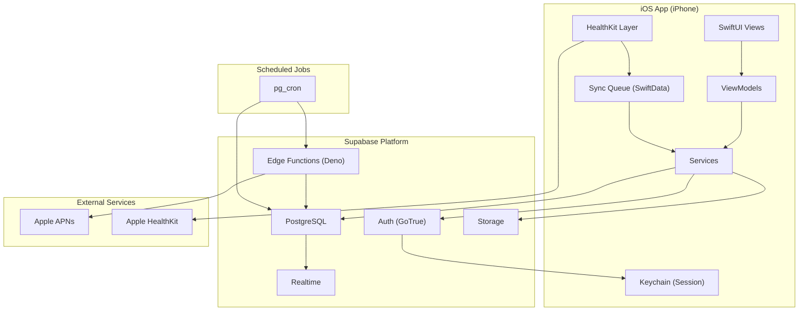
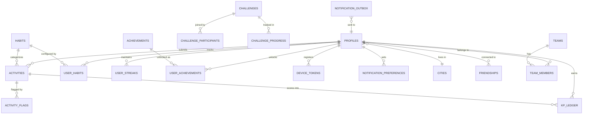
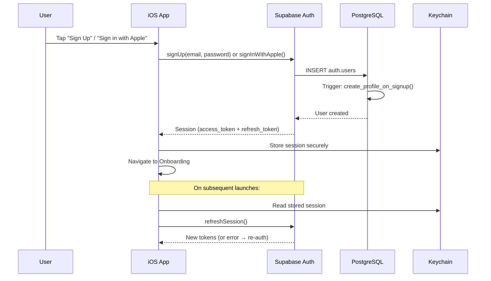
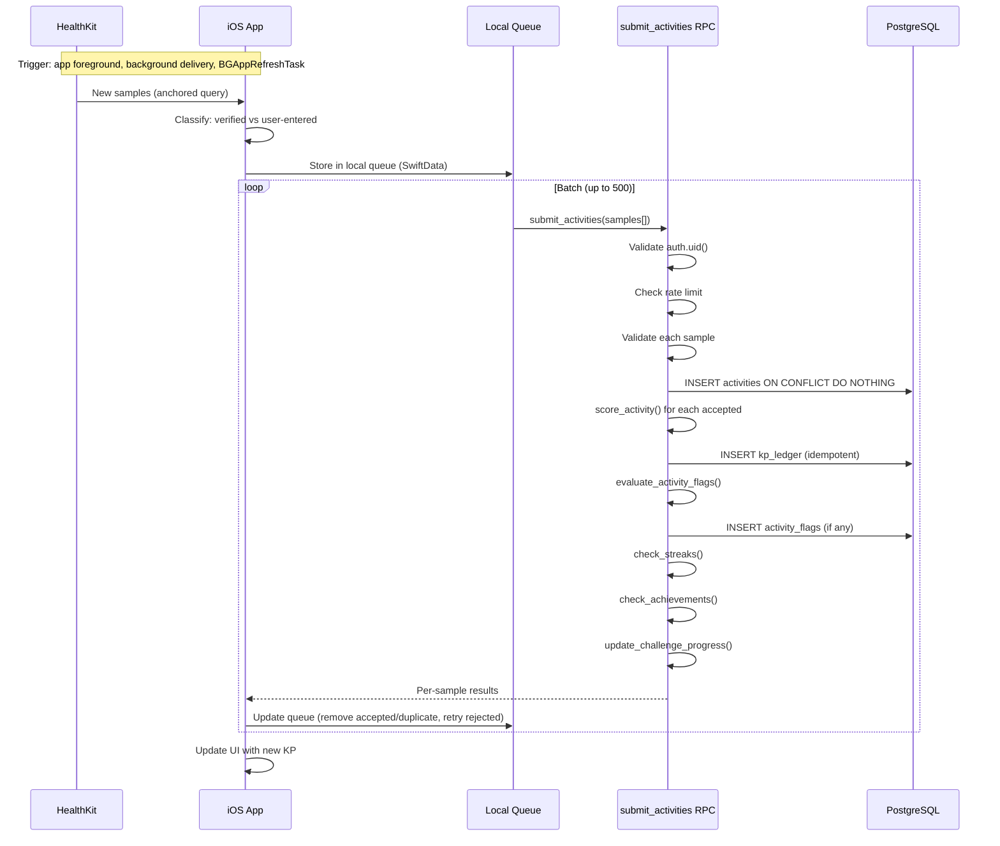
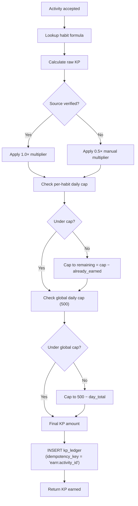
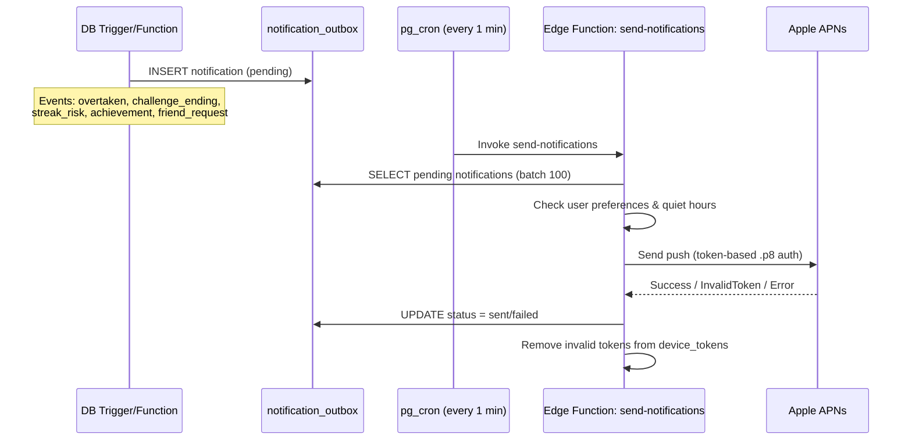
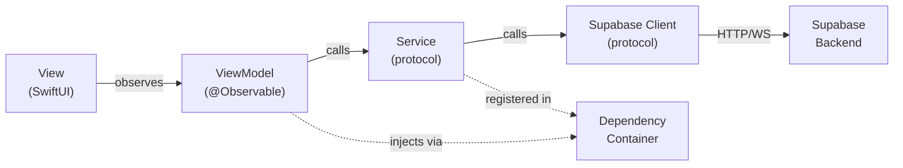

# Klymb — System Architecture

> **Version:** 0.1 (MVP)
> **Last updated:** 2026-11-21
> **Status:** Draft — awaiting founder approval
> **Depends on:** [PRD.md](./PRD.md), [KP_RULES.md](./KP_RULES.md), [ANTI_CHEAT.md](./ANTI_CHEAT.md)

---

## 1. System Overview



---

## 2. Data Model

### 2.1 Entity Relationship Diagram



### 2.2 Table Definitions

#### Core Tables

| Table | Purpose | RLS | Key Columns |
|---|---|---|---|
| `profiles` | User identity & public info | Own row read/update; public read (limited fields) | id (=auth.uid), username, display_name, avatar_preset, city_id, city_changed_at, created_at |
| `cities` | Seeded city list | Read-only for all authenticated | id, name, country, iana_timezone, latitude, longitude |
| `habits` | Seeded habit catalog | Read-only for all authenticated | id, key, display_name, unit, daily_kp_cap, manual_kp_cap, manual_allowed, formula_type |
| `user_habits` | User's active habit set | Own rows only | id, user_id, habit_id, active, created_at |

#### Activity & Scoring Tables

| Table | Purpose | RLS | Key Columns |
|---|---|---|---|
| `activities` | Submitted activity samples | Own rows read-only (insert via RPC only) | id, user_id, habit_id, quantity, started_at, ended_at, source, source_sample_id, was_user_entered, device_info, verification_status, created_at |
| `kp_ledger` | Append-only KP journal | Own rows read-only (insert via functions only) | id, user_id, amount, type, source_type, source_id, idempotency_key (unique), day_local, metadata, created_at |
| `activity_flags` | Anti-cheat flags | Admin only (users see flag status via activity view) | id, activity_id, rule, severity, status, resolved_by, resolved_at, created_at |

#### Streak & Achievement Tables

| Table | Purpose | RLS | Key Columns |
|---|---|---|---|
| `user_streaks` | Current & longest streaks | Own row read-only | user_id (PK), current_streak, longest_streak, last_qualified_date, freeze_available, freeze_used_this_week, streak_version |
| `achievements` | Achievement catalog | Read-only for all authenticated | id, key, display_name, description, condition_type, condition_value, reward_kp, icon |
| `user_achievements` | Unlocked achievements | Own rows read-only | id, user_id, achievement_id, unlocked_at |

#### Social Tables

| Table | Purpose | RLS | Key Columns |
|---|---|---|---|
| `friendships` | Friend connections | Own rows; can see mutual friends | id, requester_id, addressee_id, status (pending/accepted/blocked), created_at, updated_at |
| `teams` | Team definitions | Members read; owner updates | id, name, avatar_preset, created_by, city_id, created_at |
| `team_members` | Team membership | Own row; team members can see each other | id, team_id, user_id, role (owner/member), joined_at |

#### Challenge Tables

| Table | Purpose | RLS | Key Columns |
|---|---|---|---|
| `challenges` | Challenge definitions | Read for all authenticated | id, type (daily/weekly), habit_key, target, start_at, end_at, reward_kp, status (upcoming/active/completed/finalized) |
| `challenge_participants` | Who joined | Own rows; participants see standings | id, challenge_id, user_id, joined_at |
| `challenge_progress` | Progress tracking | Own row; standings visible to participants | id, challenge_id, user_id, current_value, completed_at, rank |

#### Notification & System Tables

| Table | Purpose | RLS | Key Columns |
|---|---|---|---|
| `device_tokens` | APNs tokens | Own rows | id, user_id, apns_token, environment (sandbox/prod), last_seen |
| `notification_preferences` | Per-type settings | Own row | user_id (PK), overtaken, challenge_ending, streak_risk, achievement, friend_request, team_invite, quiet_start, quiet_end |
| `notification_outbox` | Outbound notification queue | No client access | id, user_id, type, title, body, payload, status (pending/sent/failed), scheduled_at, sent_at, error |
| `rate_limits` | API rate tracking | No client access | id, user_id, endpoint, window_start, call_count |
| `blocked_sources` | HealthKit source blocklist | No client access | id, bundle_id_pattern, reason, added_at |
| `admin_roles` | Admin authorization | Admin only | user_id, role, granted_at, granted_by |
| `audit_log` | Admin action log | Admin only | id, admin_id, action, target_type, target_id, details, created_at |

#### Views

| View | Purpose | Refresh Strategy |
|---|---|---|
| `user_kp_total` | Total KP per user (SUM of ledger) | Regular view (computed on query) |
| `user_daily_kp` | Today's KP breakdown by habit | Regular view |
| `user_trust_score` | Trust score per user | Regular view |
| `leaderboard_daily` | Daily leaderboard | Materialized view, refreshed every 5 min |
| `leaderboard_weekly` | Weekly leaderboard | Materialized view, refreshed every 15 min |
| `leaderboard_alltime` | All-time leaderboard | Materialized view, refreshed every 30 min |

### 2.3 Indexes

| Table | Index | Purpose |
|---|---|---|
| `activities` | `(user_id, source_sample_id)` UNIQUE | Deduplication |
| `activities` | `(user_id, habit_id, started_at)` | Daily cap queries |
| `kp_ledger` | `(idempotency_key)` UNIQUE | Idempotent scoring |
| `kp_ledger` | `(user_id, day_local)` | Daily KP sums |
| `kp_ledger` | `(user_id, type)` | Filtering by type |
| `profiles` | `(username)` UNIQUE | Username lookups |
| `profiles` | `(city_id)` | City leaderboards |
| `friendships` | `(requester_id, addressee_id)` UNIQUE | Prevent duplicate requests |
| `friendships` | `(addressee_id, status)` | Pending request lookups |
| `team_members` | `(user_id)` UNIQUE | One team per user |
| `team_members` | `(team_id)` | Team member listing |
| `challenge_participants` | `(challenge_id, user_id)` UNIQUE | Prevent duplicate joins |
| `rate_limits` | `(user_id, endpoint, window_start)` UNIQUE | Rate limit lookups |

---

## 3. Auth Flow



**Key decisions:**
- Session stored in iOS Keychain (via Supabase Swift SDK)
- Access token (JWT) auto-refreshed by SDK
- Profile row auto-created by DB trigger on `auth.users` insert
- No client-side INSERT on `profiles` — trigger handles it
- Sign in with Apple returns an identity token → Supabase exchanges for session

---

## 4. Activity Sync Flow



**Within `submit_activities` (single transaction):**

1. **Auth check** — `auth.uid()` must not be null
2. **Rate limit check** — query `rate_limits`, reject if exceeded
3. **Batch size check** — reject if > 500
4. **Per-sample validation loop:**
   - Habit exists and is in user's active habits
   - Quantity > 0
   - Time range: started_at < ended_at
   - Age: started_at > now() − 7 days
   - Future: started_at < now() + 1 hour
   - Source blocklist check
5. **Insert** — `ON CONFLICT (user_id, source_sample_id) DO NOTHING`
6. **Score** — `score_activity()` for each accepted sample
7. **Flag** — `evaluate_activity_flags()` for each accepted sample
8. **Streak update** — `check_and_update_streak()` if a qualifying day threshold is newly met
9. **Achievement check** — `evaluate_achievements()` for triggered conditions
10. **Challenge progress** — `update_challenge_progress()` for active challenges the user joined
11. **Return** — array of `{sample_index, status, reason, kp_earned}`

---

## 5. Scoring Flow



**Cap query (pseudo-SQL):**
```sql
-- Per-habit cap check
SELECT COALESCE(SUM(amount), 0)
FROM kp_ledger
WHERE user_id = $1
  AND day_local = $user_local_date
  AND source_type = 'activity'
  AND metadata->>'habit_key' = $habit_key
  AND type = 'earn';

-- Global daily cap check
SELECT COALESCE(SUM(amount), 0)
FROM kp_ledger
WHERE user_id = $1
  AND day_local = $user_local_date
  AND type = 'earn';
```

---

## 6. Leaderboard Strategy

### Decision: **Materialized Views + pg_cron Refresh**

**Why materialized views over alternatives:**

| Strategy | Pros | Cons | Verdict |
|---|---|---|---|
| Regular views | Always fresh | Slow with 100K+ users (full SUM every query) | ❌ |
| **Materialized views** | **Fast reads, simple, built-in** | **Stale by refresh interval** | ✅ **Chosen** |
| Incremental aggregate table | Real-time, fast | Complex to maintain, trigger overhead | Post-MVP |
| Application cache (Redis) | Very fast | Extra infrastructure, Supabase doesn't include Redis | ❌ |

### Refresh Schedule

| View | Refresh Interval | pg_cron Expression | Rationale |
|---|---|---|---|
| `leaderboard_daily` | Every 5 minutes | `*/5 * * * *` | Daily competition feels near-real-time |
| `leaderboard_weekly` | Every 15 minutes | `*/15 * * * *` | Weekly is less urgent |
| `leaderboard_alltime` | Every 30 minutes | `*/30 * * * *` | All-time changes slowly |

### Materialized View Structure

```sql
CREATE MATERIALIZED VIEW leaderboard_daily AS
SELECT
    p.id AS user_id,
    p.username,
    p.avatar_preset,
    p.city_id,
    tm.team_id,
    COALESCE(SUM(kl.amount), 0) AS kp,
    RANK() OVER (ORDER BY COALESCE(SUM(kl.amount), 0) DESC) AS global_rank,
    RANK() OVER (PARTITION BY p.city_id ORDER BY COALESCE(SUM(kl.amount), 0) DESC) AS city_rank
FROM profiles p
LEFT JOIN kp_ledger kl ON kl.user_id = p.id
    AND kl.day_local = CURRENT_DATE
    AND kl.type IN ('earn', 'revoke', 'reinstate')
LEFT JOIN user_trust_score uts ON uts.user_id = p.id
LEFT JOIN team_members tm ON tm.user_id = p.id
WHERE uts.trust_score >= 20  -- exclude suspended users
GROUP BY p.id, p.username, p.avatar_preset, p.city_id, tm.team_id
WITH DATA;

CREATE UNIQUE INDEX ON leaderboard_daily (user_id);
CREATE INDEX ON leaderboard_daily (city_id, city_rank);
CREATE INDEX ON leaderboard_daily (global_rank);
```

### Team Leaderboard

Derived from individual leaderboard by aggregating team member KP:

```sql
-- Team daily leaderboard (derived query in RPC, not separate mat view)
SELECT
    t.id AS team_id,
    t.name,
    t.avatar_preset,
    t.city_id,
    SUM(ld.kp) AS team_kp,
    RANK() OVER (ORDER BY SUM(ld.kp) DESC) AS team_rank
FROM teams t
JOIN team_members tm ON tm.team_id = t.id
JOIN leaderboard_daily ld ON ld.user_id = tm.user_id
GROUP BY t.id, t.name, t.avatar_preset, t.city_id;
```

### RPC Interface

```sql
-- get_leaderboard(scope, period, city_id, limit, offset)
-- scope: 'global' | 'city' | 'friends' | 'team'
-- period: 'daily' | 'weekly' | 'alltime'
-- Returns: [{rank, user_id, username, avatar_preset, kp, rank_change}]

-- get_my_rank(scope, period, city_id)
-- Returns: {rank, kp, next_user, kp_to_overtake}
```

---

## 7. Notification Flow



**Notification sources (how they're enqueued):**

| Event | Trigger Point | Implementation |
|---|---|---|
| Overtaken on leaderboard | After materialized view refresh | pg_cron job compares current vs previous rank snapshot |
| Challenge ending soon | 2 hours before challenge end_at | pg_cron job checks upcoming deadlines |
| Streak at risk | 8 PM user-local time, no qualifying activity today | pg_cron job (hourly check) |
| Achievement unlocked | Inside `evaluate_achievements()` | Direct INSERT to outbox |
| Friend request | Inside `send_friend_request()` RPC | Direct INSERT to outbox |
| Team invite | Inside team invite RPC | Direct INSERT to outbox |

**Edge Function: `send-notifications`**
- Runtime: Deno (Supabase Edge Functions)
- Auth: APNs token-based with .p8 key from env secrets
- Batch: processes up to 100 pending notifications per invocation
- Retry: failed notifications retried up to 3 times with backoff
- Invalid tokens: removed from `device_tokens` on `410 Gone` or `BadDeviceToken`
- Logging: structured JSON, **never logs tokens or health data**
- Schedule: invoked via pg_cron every 1 minute

---

## 8. Environments

| Environment | Purpose | Supabase Project | Database | Edge Functions | iOS Build |
|---|---|---|---|---|---|
| **Local** | Development | `supabase start` (Docker) | Local Postgres | Local Deno | Xcode simulator, `Staging.xcconfig` |
| **Staging** | Pre-prod testing | Separate Supabase project | Supabase-hosted | Deployed | TestFlight, `Staging.xcconfig` |
| **Production** | Live users | Separate Supabase project | Supabase-hosted | Deployed | App Store, `Prod.xcconfig` |

### Environment Config

**iOS (xcconfig files — gitignored):**
```
// Staging.xcconfig
SUPABASE_URL = https://<staging-ref>.supabase.co
SUPABASE_ANON_KEY = eyJ...staging
APNS_ENVIRONMENT = sandbox

// Prod.xcconfig
SUPABASE_URL = https://<prod-ref>.supabase.co
SUPABASE_ANON_KEY = eyJ...prod
APNS_ENVIRONMENT = production
```

**Supabase secrets (set via CLI/dashboard — never in code):**
```
APNS_KEY_ID=...
APNS_TEAM_ID=...
APNS_PRIVATE_KEY=...   # .p8 file contents
APNS_BUNDLE_ID=Harshit-kumar.klymb
```

### Migration Strategy

```
Local development
    │
    ▼
supabase db reset && supabase test db  (CI on every PR)
    │
    ▼
Merge to main
    │
    ▼
supabase db push --linked  (staging, manual or CD)
    │
    ▼
Smoke test on staging
    │
    ▼
supabase db push --linked  (prod, manual with checklist)
```

---

## 9. iOS App Architecture

### 9.1 Module Layout

```
klymb/
├── App/
│   ├── klymbApp.swift              # @main entry, root scene
│   ├── AppEnvironment.swift         # Reads xcconfig values
│   ├── AppState.swift               # Auth state: .auth / .onboarding / .main
│   └── DependencyContainer.swift    # Protocol-based DI
│
├── Core/
│   ├── Networking/
│   │   ├── SupabaseClientProtocol.swift
│   │   ├── SupabaseClient.swift     # Wraps supabase-swift
│   │   └── ErrorMapper.swift        # RPC errors → user-friendly
│   ├── Models/
│   │   ├── Profile.swift
│   │   ├── Activity.swift
│   │   ├── KPLedgerEntry.swift
│   │   ├── Challenge.swift
│   │   ├── Achievement.swift
│   │   ├── Team.swift
│   │   └── ...
│   └── Extensions/
│       ├── Date+LocalDay.swift
│       └── ...
│
├── Services/
│   ├── AuthService.swift            # Protocol + impl
│   ├── ProfileService.swift
│   ├── HealthKitService.swift       # Protocol + impl + mock
│   ├── ActivitySyncService.swift    # Queue, batch, retry
│   ├── LeaderboardService.swift
│   ├── ChallengeService.swift
│   ├── FriendService.swift
│   ├── TeamService.swift
│   ├── NotificationService.swift
│   ├── AchievementService.swift
│   └── AnalyticsService.swift       # Protocol (no PII)
│
├── Features/
│   ├── Auth/
│   │   ├── WelcomeView.swift
│   │   ├── SignUpView.swift
│   │   ├── LoginView.swift
│   │   └── AuthViewModel.swift
│   ├── Onboarding/
│   │   ├── OnboardingFlow.swift
│   │   ├── UsernameStep.swift
│   │   ├── CityStep.swift
│   │   ├── HabitStep.swift
│   │   └── OnboardingViewModel.swift
│   ├── Home/
│   │   ├── HomeView.swift
│   │   └── HomeViewModel.swift
│   ├── Compete/
│   │   ├── CompeteView.swift
│   │   ├── LeaderboardView.swift
│   │   └── CompeteViewModel.swift
│   ├── Log/
│   │   ├── ManualLogView.swift
│   │   └── ManualLogViewModel.swift
│   ├── Challenges/
│   │   ├── ChallengesView.swift
│   │   ├── ChallengeDetailView.swift
│   │   └── ChallengesViewModel.swift
│   ├── Profile/
│   │   ├── ProfileView.swift
│   │   ├── AchievementsGrid.swift
│   │   ├── ActivityHistory.swift
│   │   └── ProfileViewModel.swift
│   ├── Friends/
│   │   ├── FriendsView.swift
│   │   └── FriendsViewModel.swift
│   ├── Teams/
│   │   ├── TeamView.swift
│   │   ├── CreateTeamView.swift
│   │   └── TeamViewModel.swift
│   └── Settings/
│       ├── SettingsView.swift
│       └── SettingsViewModel.swift
│
├── DesignSystem/
│   ├── Tokens/
│   │   ├── Colors.swift
│   │   ├── Typography.swift
│   │   └── Spacing.swift
│   ├── Components/
│   │   ├── PrimaryButton.swift
│   │   ├── Card.swift
│   │   ├── RankBadge.swift
│   │   ├── ProgressRing.swift
│   │   ├── KPCounter.swift
│   │   ├── LeaderboardRow.swift
│   │   ├── ChallengeCard.swift
│   │   ├── Toast.swift
│   │   ├── EmptyState.swift
│   │   ├── ErrorState.swift
│   │   └── SkeletonLoader.swift
│   ├── Haptics.swift
│   └── PreviewGallery.swift
│
├── Resources/
│   ├── Assets.xcassets/
│   └── Localizable.strings
│
└── SyncQueue/
    ├── SyncQueueModel.swift          # SwiftData model
    └── SyncQueueManager.swift
```

### 9.2 Architectural Patterns



| Pattern | Implementation |
|---|---|
| **UI framework** | SwiftUI (declarative, thin views) |
| **State management** | `@Observable` ViewModels (iOS 17+) |
| **Navigation** | `NavigationStack` with typed routes via enum |
| **Dependency injection** | Protocol-based, registered in `DependencyContainer` |
| **Async** | Swift Concurrency (async/await, Task, actors) |
| **Local persistence** | SwiftData (sync queue), Keychain (session), UserDefaults (anchors, preferences) |
| **Networking** | supabase-swift SDK (Auth, PostgREST, Realtime, Storage) |
| **Error handling** | `ErrorMapper` converts RPC codes → user-friendly `AppError` enum |
| **Testing** | XCTest + protocol mocks (no third-party mock libraries) |

### 9.3 Navigation Structure

```
TabView
├── Home (tab 0)
│   └── NavigationStack
│       ├── HomeView
│       └── → ActivityDetail
│
├── Log (tab 1)
│   └── NavigationStack
│       ├── ManualLogView
│       └── → Confirmation
│
├── Compete (tab 2)
│   └── NavigationStack
│       ├── CompeteView (leaderboards)
│       ├── → PublicProfileSheet
│       └── → TeamView
│
├── Challenges (tab 3)
│   └── NavigationStack
│       ├── ChallengesView (list)
│       └── → ChallengeDetailView
│
└── Profile (tab 4)
    └── NavigationStack
        ├── ProfileView
        ├── → AchievementsGrid
        ├── → ActivityHistory
        ├── → FriendsView
        ├── → TeamView
        └── → SettingsView
```

### 9.4 Minimum iOS Version

**Recommended: iOS 17.0**

| iOS Version | Tradeoffs |
|---|---|
| iOS 16 | Wider reach, but no `@Observable`, older `NavigationStack` APIs |
| **iOS 17** | **`@Observable`, mature SwiftData, `NavigationStack` improvements, Swift Charts, 90%+ of active iPhones** |
| iOS 18 | Newest APIs, but excludes ~25% of devices |

> **⚠️ OPEN DECISION — iOS 17.0 is recommended. The Xcode project currently targets iOS 26.2 (latest Xcode SDK). This should be lowered to iOS 17.0 for wider reach.**

---

## 10. Error Handling

### 10.1 Server-Side Errors

All RPCs return structured errors:

```json
{
  "error": {
    "code": "HABIT_NOT_ACTIVE",
    "message": "The habit 'running' is not in your active habits.",
    "details": null
  }
}
```

**Error codes:**

| Code | HTTP Status | User Message |
|---|---|---|
| `AUTH_REQUIRED` | 401 | "Please sign in to continue." |
| `RATE_LIMITED` | 429 | "You're doing that too fast. Try again in a moment." |
| `INVALID_INPUT` | 400 | "Some fields are missing or invalid." |
| `HABIT_NOT_ACTIVE` | 400 | "This habit isn't in your active tracking list." |
| `CITY_CHANGE_LIMIT` | 400 | "You can change your city once every 30 days." |
| `USERNAME_TAKEN` | 409 | "This username is already taken." |
| `USERNAME_BLOCKED` | 400 | "This username is not available." |
| `BATCH_TOO_LARGE` | 400 | "Too many activities in one sync. Max 500." |
| `SAMPLE_TOO_OLD` | 400 | "This activity is too old to sync (max 7 days)." |
| `SAMPLE_FUTURE` | 400 | "This activity has a future date." |
| `CHALLENGE_FULL` | 400 | "This challenge is no longer accepting participants." |
| `ALREADY_IN_TEAM` | 409 | "You're already on a team. Leave first to join another." |
| `TEAM_FULL` | 400 | "This team has reached its member limit." |
| `INTERNAL` | 500 | "Something went wrong. Please try again." |

### 10.2 Client-Side Error Handling

```swift
enum AppError: Error, LocalizedError {
    case network(URLError)
    case auth(AuthError)
    case rpc(code: String, message: String)
    case healthKit(HKError)
    case unknown(Error)

    var userMessage: String {
        switch self {
        case .network: return "No internet connection. Check your network."
        case .auth(.sessionExpired): return "Your session expired. Please sign in again."
        case .rpc(let code, _): return ErrorMapper.map(code)
        case .healthKit: return "Could not access Health data. Check permissions in Settings."
        case .unknown: return "Something went wrong. Please try again."
        }
    }
}
```

### 10.3 Error Display

| Context | Display Method |
|---|---|
| **Network down** | Persistent banner at top of screen |
| **RPC error** | Toast notification (auto-dismiss 4s) |
| **Form validation** | Inline field error |
| **Fatal / session expired** | Full-screen error state with action button |
| **Force update** | Full-screen blocking overlay with App Store link |

---

## 11. Observability

### 11.1 MVP Observability Stack

| Layer | Tool | What It Covers |
|---|---|---|
| **Database** | Supabase Dashboard | Query performance, connections, storage |
| **Edge Functions** | Structured logging (JSON to stdout) | Notification sends, errors, latencies |
| **iOS** | Privacy-respecting analytics (custom) | Key events (no PII, no health data) |
| **Crashes** | TBD (Crashlytics or Sentry) | Crash-free rate, stack traces |

### 11.2 Key Metrics to Monitor

| Metric | Source | Alert Threshold |
|---|---|---|
| Sync success rate | Server logs | < 95% |
| Avg sync latency (p95) | Server logs | > 5s |
| Auth success rate | Supabase Auth dashboard | < 98% |
| Leaderboard refresh time | pg_cron logs | > 30s |
| Notification delivery rate | Edge Function logs | < 90% |
| Flag rate | activity_flags table | > 5% of submissions |
| Crash-free sessions | Crash reporter | < 99.5% |
| DB connections | Supabase dashboard | > 80% of pool |

### 11.3 Analytics Events (Privacy-Respecting)

| Event | Properties | PII |
|---|---|---|
| `onboarding_step` | step_name, step_index | None |
| `first_sync` | habit_count, sample_count | None |
| `first_kp` | amount | None |
| `challenge_join` | challenge_type | None |
| `notification_opt_in` | — | None |
| `manual_log` | habit_key | None |
| `app_open` | session_number | None |
| `error` | error_code, screen | None |

**Rules:** No health quantities, no usernames, no emails, no device IDs, no location. Events are anonymous counts only.

---

## 12. pg_cron Jobs

| Job | Schedule | Function |
|---|---|---|
| Refresh `leaderboard_daily` | `*/5 * * * *` | `REFRESH MATERIALIZED VIEW CONCURRENTLY` |
| Refresh `leaderboard_weekly` | `*/15 * * * *` | `REFRESH MATERIALIZED VIEW CONCURRENTLY` |
| Refresh `leaderboard_alltime` | `*/30 * * * *` | `REFRESH MATERIALIZED VIEW CONCURRENTLY` |
| Create daily challenges | `0 0 * * *` (midnight UTC) | `create_daily_challenges()` |
| Create weekly challenges | `0 0 * * 1` (Monday midnight UTC) | `create_weekly_challenges()` |
| Finalize expired challenges | `*/5 * * * *` | `finalize_expired_challenges()` |
| Streak risk notifications | `0 * * * *` (hourly) | `enqueue_streak_risk_notifications()` |
| Send notifications | `* * * * *` (every minute) | Invoke Edge Function `send-notifications` |
| Restock streak freezes | `0 0 * * 1` (Monday midnight UTC) | `restock_streak_freezes()` |
| Clean old rate limits | `0 * * * *` (hourly) | `DELETE FROM rate_limits WHERE window_start < now() - interval '2 hours'` |

---

## 13. Open Decisions

| # | Decision | Options | Recommendation | Impact |
|---|---|---|---|---|
| OD1 | **Minimum iOS version** | 17.0 vs 18.0 | 17.0 (wider reach, `@Observable` available) | Device support, API availability |
| OD2 | **Leaderboard staleness tolerance** | 5/15/30 min vs real-time | 5 min daily (chosen) — revisit if users complain | UX vs DB load |
| OD3 | **Crash reporting vendor** | Firebase Crashlytics vs Sentry vs defer | Defer to post-MVP (not blocking) | Operational visibility |
| OD4 | **SwiftData vs SQLite for sync queue** | SwiftData (simpler) vs SQLite (more control) | SwiftData (iOS 17+ aligns with min target) | Reliability, complexity |
| OD5 | **Ledger anonymization on delete** | Anonymize (null user_id) vs hard delete | Anonymize (preserves leaderboard integrity) | Privacy vs data integrity |
| OD6 | **Team leaderboard: separate mat view?** | Derived from individual view vs own mat view | Derived (simpler, team count is small in MVP) | Performance at scale |
| OD7 | **Notification delivery: polling vs webhook** | pg_cron polling every 1 min vs Supabase webhook | pg_cron polling (simpler, no external deps) | Latency (1 min max) |
| OD8 | **Rank change tracking** | Snapshot table vs diff on refresh | Snapshot table (previous_rank stored per user per period) | Storage vs query complexity |
| OD9 | **Background sync strategy** | BGAppRefreshTask only vs + background processing | Both (BGAppRefreshTask + background delivery handlers) | Battery impact, data freshness |
| OD10 | **Team feature in navigation** | Separate tab vs under Compete tab | Under Compete tab (avoid 6-tab overload) | Navigation complexity |
